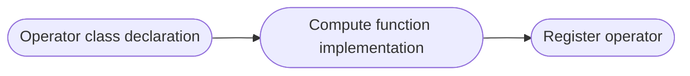

# AI CPU Operator Development Guide

<!-- md-trans-meta sourceCommit=unknown translatedAt=2026-11-18T08:05:51.536Z pushedAt=2026-11-18T09:59:29.659Z nl=2 -->

## Overview

### Instructions

Operators are classified into AI Core operators and AI CPU operators (a few) based on the hardware unit on which they run. The former are developed in Ascend C and run on the AI Core hardware unit. The latter are developed in C++ and run on the AI CPU hardware unit.

This document focuses on how to develop AI CPU operators based on a standard project. To contribute AI Core operators, see [AI Core Operator Development Guide](./aicore_develop_guide.md).

Before developing an operator, understand the following information:

- Basic knowledge: Learn the C++ programming language first to understand its basic syntax and principles. See [*TBE & AI CPU Operator Development*](https://hiascend.com/en/document/redirect/CannCommunityOpdevWizard) to become familiar with the hardware architecture and development APIs.

### Development Process

Using the `AddExample` operator as an example, this section describes the complete process and deliverables of standard AI CPU operator development. For the complete sample, see the `examples` directory of the project.

1. [Prerequisites](../../../README.md): Complete environment preparation and source code download by referring to the project README. Details are not repeated here.

2. [Project Creation](#project-creation): Create the standard operator project directory to facilitate subsequent operator compilation and deployment.

3. [Operator Definition](#operator-definition): Determine the operator function and prototype definition.

4. [Kernel Implementation](#kernel-implementation): Implement the operator kernel function on the device side.

5. [aclnn Adaptation](#aclnn-adaptation): For custom operators, the aclnn API call is recommended, and binary release must be completed in advance. **If the operator is called in graph mode**, refer to [Graph Mode Adaptation Guide](./graph_develop_guide.md).

6. [Build and Deployment](#build-and-deployment): Complete the build and installation of the custom operator through the project build script.

7. [Operator Verification](#operator-verification): Verify the custom operator function through common operator call methods.

## Project Creation

Directory creation is an important step in operator development. It provides a unified directory structure and file organization for subsequent code writing, compilation, and debugging.

Use `build.sh` to quickly create the operator directory. Go to the project root directory and run the following command:

```bash
# Create the specified operator directory, for example, bash build.sh --genop_aicpu=examples/add_example
# ${op_class} indicates the operator type, for example, the image type.
# ${op_name} indicates the lowercase underscore form of the operator name. For example, the `AddExample` operator corresponds to add_example. A newly added operator is not allowed to have the same name as an existing operator.
bash build.sh --genop_aicpu=${op_class}/${op_name}
```

After the command is executed successfully, the following prompt information is displayed:

```bash
Create the AI CPU initial directory for ${op_name} under ${op_class} success
```

After creation, the directory structure is as follows:

```tex
${op_name}                              # Replace with the lowercase underscore form of the actual operator name
├── examples                            # Operator call examples
│   └── test_aclnn_${op_name}.cpp       # aclnn call example of the operator
├── op_host                             # Host-side implementation
│   └── ${op_name}_infershape.cpp       # InferShape implementation, which implements operator shape inference and derives the output shape at runtime
├── op_kernel_aicpu                     # Device-side Kernel implementation
│   ├── ${op_name}_aicpu.cpp            # Kernel entry file, which includes the main function and scheduling logic
│   ├── ${op_name}_aicpu.h              # Kernel header file, which includes function declarations, structure definitions, and logic implementation
│   └── ${op_name}.json                 # Operator information library, which defines basic operator information such as name, input, output, and data type
├── tests                               # UT implementation
│   └── ut                              # kernel/aclnn UT implementation
└── CMakeLists.txt                      # Operator cmakelist entry
```

If ```${op_class}``` is a new operator classification, additionally add `add_subdirectory(${op_class})` in `CMakeLists`. Otherwise, compilation fails.

```Cpp
if(ENABLE_EXPERIMENTAL)
  # genop adds an experimental operator classification
  # add_subdirectory(${op_class})
  add_subdirectory(experimental/image)
else()
  # genop adds a non-experimental operator classification
  # add_subdirectory(${op_class})
  add_subdirectory(image)
endif()
```

## Operator Definition

Operator definition requires two deliverables: `README.md` and ```${op_name}.json```.

**Deliverable 1: README.md**

Before developing an operator, determine the function and computation logic of the target operator.

Using the custom `AddExample` operator description as an example, see [AddExample Operator Description](../../../examples/add_example_aicpu/README.md).

**Deliverable 2: ${op_name}.json**

Operator information library.

Using the custom `AddExample` operator description as an example, see [AddExample Operator Information Library](../../../examples/add_example_aicpu/op_kernel_aicpu/add_example.json).

## Kernel Implementation

### Kernel Introduction

Kernel is the core part of an operator executed on the NPU. Kernel implementation includes the following steps:



### Code Implementation

Kernel requires two deliverables: ```${op_name}_aicpu.cpp``` and ```${op_name}_aicpu.h```.

**Deliverable 1: ${op_name}_aicpu.h**

Operator class declaration

The first step of Kernel implementation is to declare the operator class in the header file ```op_kernel_aicpu/${op_name}_aicpu.h```. The operator class must inherit from the CpuKernel base class.
To view the detailed implementation, see [add_example_aicpu_aicpu.h](../../../examples/add_example_aicpu/op_kernel_aicpu/add_example_aicpu_aicpu.h).

```CPP
// 1. Operator class declaration
// Include the AI CPU base library header file
#include "cpu_kernel.h"
// Define the namespace aicpu (fixed and not allowed to be modified), and define the operator Compute implementation function
namespace aicpu {
// The operator class inherits from the CpuKernel base class
class AddExampleCpuKernel : public CpuKernel {
 public:
  ~AddExampleCpuKernel() = default;
  // Declare the Compute function (which needs to be overridden). The parameter CpuKernelContext is the context of CPUKernel, including operator input, output, and attribute information
  uint32_t Compute(CpuKernelContext &ctx) override;
};
}  // namespace aicpu
```

**Deliverable 2: ${op_name}_aicpu.cpp**

Compute function implementation and AI CPU operator registration

Obtain the input/output Tensor information and perform validity verification, then implement the core computation logic (such as addition), and set the computation result to the output Tensor.

To view the detailed implementation, see [add_example_aicpu_aicpu.cpp](../../../examples/add_example_aicpu/op_kernel_aicpu/add_example_aicpu_aicpu.cpp).

```C++
// 2. Compute function implementation
#include "add_example_aicpu.h"

namespace {
// Operator name
const char* const kAddExample = "AddExample";
const uint32_t kParamInvalid = 1;
}  // namespace

// Define the namespace aicpu
namespace aicpu {
// Implement the Compute function of the custom operator class
uint32_t AddExampleCpuKernel::Compute(CpuKernelContext& ctx) {
  // Obtain the input tensor from CpuKernelContext
  Tensor* input0 = ctx.Input(0);
  Tensor* input1 = ctx.Input(1);
  // Obtain the output tensor from CpuKernelContext
  Tensor* output = ctx.Output(0);

  // Perform basic validation on the tensor to check whether it is a null pointer
  if (input0 == nullptr || input1 == nullptr || output == nullptr) {
    return kParamInvalid;
  }

  // Obtain the data type of the input tensor
  auto data_type = static_cast<DataType>(input0->GetDataType());
  // Obtain the data address of the input tensor, for example, when the input data type is int32
  auto input0_data = reinterpret_cast<int32_t*>(input0->GetData());
  // Obtain the shape of the tensor
  auto input0_shape = input0->GetTensorShape();

  // Obtain the data address of the output tensor, for example, when the output data type is int32
  auto y = reinterpret_cast<int32_t*>(output->GetData());

  // The AddCompute function performs the corresponding computation according to the input type.
  // Because C++ does not natively support the half-precision floating-point type, use the third-party library Eigen (version 3.3.9 recommended) to represent it.
  switch (data_type) {
    case DT_FLOAT:
      return AddCompute<float>(...);
    case DT_INT32:
      return AddCompute<int32_t>(...);
      ....
    default : return kParamInvalid;
  }
}

// 3. Register the operator Kernel implementation, which is used by the framework to obtain the Compute function of the operator Kernel.
REGISTER_CPU_KERNEL(kAddExample, AddExampleCpuKernel);
}  // namespace aicpu
```

## aclnn Adaptation

After operator development and compilation are complete, the aclnn API (a set of C-based APIs) is automatically generated. No other configuration is required. Call the aclnn API directly in the application to call the operator.

## Build and Deployment

After operator development is complete, build the operator project to generate the custom operator installation package *.run. Perform the following operations:

1. **Prepare the environment.**

    Refer to [Project Creation](#project-creation) to complete the basic environment setup. Check whether the operator development deliverables are complete and located in the corresponding operator classification directory.

2. **Compile the custom operator package.**

    Using the `AddExample` operator as an example, assume that the development deliverables are in the `examples` directory. For the complete code, see the [add_example_aicpu](../../../examples/add_example_aicpu) directory.

    ```bash
    # Compile the specified operator, for example, bash build.sh --pkg --ops=add_example -j16
    bash build.sh --pkg --soc=${soc_version} --vendor_name=${vendor_name} --ops=${op_list} [--experimental] [-j${n}]
    ```

    - --soc: \$\{soc\_version\} indicates the NPU model. Atlas A2 products use "ascend910b" (default), Atlas A3 products use "ascend910_93", and Ascend 950PR&950DT products use "ascend950".
    - --vendor_name (optional): \$\{vendor\_name\} indicates the name of the custom operator package to build. The default name is custom.
    - --ops (optional): \$\{op\_list\} indicates the operators to compile. If not specified, all operators are compiled by default. The format is "--ops=add_example".
    - --experimental (optional): If the operator to compile is a contributed operator, configure --experimental.
    - -j (optional): Specifies the number of compilation threads to speed up compilation.

    If the following information is displayed, the compilation is successful:

    ```bash
    Self-extractable archive "cann-ops-cv-${vendor_name}-linux.${arch}.run" successfully created.
    ```

3. **Install the custom operator package.**

    ```bash
    # Install the run package
    ./build_out/cann-ops-cv-${vendor_name}-linux.${arch}.run
    ```

    The custom operator package is installed in the ```${ASCEND_HOME_PATH}/opp/vendors``` path. ```${ASCEND_HOME_PATH}``` indicates the CANN software installation directory, which can be configured in environment variables in advance.

4. **(Optional) Uninstall the custom operator package.**

    After the custom operator package is installed, `uninstall.sh` is generated in the ```${ASCEND_HOME_PATH}/opp/vendors/${vendor_name:-custom}_cv/scripts``` directory. `vendor_name` must be consistent with the value used when building the operator package. If it is not set, the default value `custom` is used. Use this script to uninstall the corresponding custom operator package. The command is as follows:

    ```bash
    bash "${ASCEND_HOME_PATH}/opp/vendors/${vendor_name:-custom}_cv/scripts/uninstall.sh"
    ```

## Operator Verification

Before verifying the operator, ensure that the environment variable has been configured. The command is as follows:

```bash
export LD_LIBRARY_PATH=${ASCEND_HOME_PATH}/opp/vendors/${vendor_name}_cv/op_api/lib:${LD_LIBRARY_PATH}
export ASCEND_CUSTOM_OPP_PATH=${ASCEND_HOME_PATH}/opp/vendors/${vendor_name}_cv
```

- **UT Verification**

  During operator development, use UT verification (such as Kernel) for quick verification. To view the detailed implementation, see [Kernel UT](../../../examples/add_example_aicpu/tests/ut/op_kernel_aicpu/test_add_example_aicpu.cpp).

- **aclnn Call Verification**

  After the developed operator is compiled and deployed, its function can be verified through the aclnn method. Refer to [operator call method](../invocation/quick_op_invocation.md).
